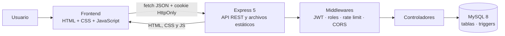
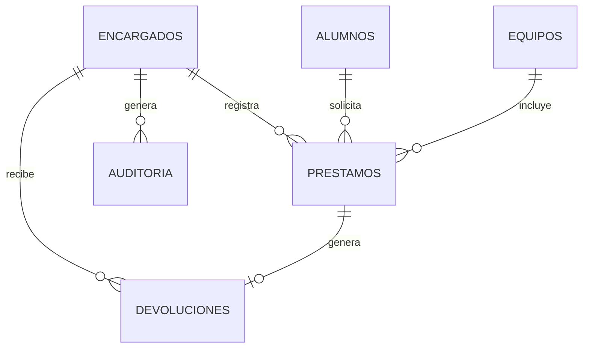

<div align="center">


# SmartLoanIT

**Sistema de gestión de préstamos de equipos tecnológicos para instituciones educativas**

Registra alumnos y equipos, controla la disponibilidad, genera comprobantes y calcula multas por retraso con trazabilidad completa de cada movimiento.

<p>
  <a href="https://nodejs.org/"></a>
  <a href="https://expressjs.com/"></a>
  <a href="https://www.mysql.com/"></a>
  <a href="https://developer.mozilla.org/docs/Web/JavaScript"></a>
  <a href="https://www.docker.com/"></a>
</p>

<sub>Proyecto académico · 2026</sub>

</div>

---

## Contenido

- [Descripción](#descripción)
- [Funcionalidades](#funcionalidades)
- [Tecnologías](#tecnologías)
- [Arquitectura](#arquitectura)
- [Estructura del proyecto](#estructura-del-proyecto)
- [Requisitos](#requisitos)
- [Instalación y configuración](#instalación-y-configuración)
- [Ejecución](#ejecución)
- [API](#api)
- [Base de datos](#base-de-datos)
- [Seguridad y permisos](#seguridad-y-permisos)
- [Capturas de pantalla](#capturas-de-pantalla)
- [Estado del proyecto](#estado-del-proyecto)
- [Autoría y licencia](#autoría-y-licencia)

---

## Descripción

SmartLoanIT es una aplicación web para administrar el ciclo completo de préstamo de equipos institucionales en una institución educativa: laptops, PCs y periféricos. Centraliza el inventario, el registro de alumnos, la salida y devolución de equipos, el cálculo de multas y la auditoría de las operaciones.

El problema que resuelve es la dispersión de registros manuales: sin un sistema centralizado se pierde el rastro de quién tiene cada equipo, cuándo debe devolverlo y en qué condiciones lo recibió. SmartLoanIT reemplaza ese seguimiento por un flujo único con estados, validaciones y comprobantes imprimibles.

Está pensado para encargados de equipos institucionales de colegios e instituciones educativas. La interfaz está en español, usa guaraníes (Gs.) como moneda y registra las fechas en la zona horaria de Paraguay (`America/Asuncion`).

## Funcionalidades

| Módulo | Qué permite |
|---|---|
| **Acceso y sesiones** | Inicio de sesión con código de encargado y contraseña. La sesión se transporta en una cookie `HttpOnly`; el cierre de sesión revoca los tokens emitidos. |
| **Dashboard** | Métricas de inventario y préstamos activos, gráfico donut de distribución de equipos, actividad reciente, reloj y actualización automática cada 30 segundos. |
| **Alertas de vencimiento** | Campana en el dashboard con préstamos vencidos o por vencer en las próximas 48 horas. Se actualiza cada 60 segundos y al volver a la pestaña. |
| **Alumnos** | Alta con código automático (`ALU001`, `ALU002`, …), edición, búsqueda sin acentos y baja lógica que conserva el historial. |
| **Equipos** | Registro y edición de activos; estados `Disponible`, `Prestado` y `En mantenimiento`. El cambio manual solo se permite entre `Disponible` y `En mantenimiento`; la baja solo procede si no hay historial de préstamos. |
| **Préstamos** | Selección de alumnos sin préstamo activo y equipos disponibles; aceptación del contrato, validación de fechas, código correlativo (`PRE-001`, `PRE-002`, …) y comprobante imprimible con firmas. |
| **Devoluciones** | Búsqueda de préstamos activos, registro del estado del equipo y de daños, cálculo automático de días de retraso, multa y total a cobrar; comprobante imprimible. |
| **Historial** | Tablas de préstamos y devoluciones con filtros, búsqueda y anulaciones con motivo. Incluye una pestaña de auditoría visible solo para administradores. |
| **Usuarios** | Solo administradores: alta, edición, cambio de rol y contraseña, activación y desactivación de encargados. |
| **Configuración** | Solo administradores: edición de la multa diaria desde el dashboard. El cambio queda registrado en la auditoría. |
| **Exportación** | Descarga de un archivo Excel (`.xlsx`) con hojas `Resumen`, `Préstamos` y `Devoluciones`, indicadores, filtros, totales y formato institucional. |

La interfaz incluye tema oscuro y claro con persistencia, búsqueda Spotlight (`Ctrl`/`Cmd` + `K`), notificaciones tipo toast, modales de confirmación, diseño responsive y estilos de impresión para los comprobantes.

> **Tasa de multa:** al crear un préstamo, la multa diaria vigente se guarda en `prestamos.multa_base`. Los préstamos existentes conservan esa tasa aunque la configuración cambie. En registros antiguos sin ese valor se utiliza la configuración actual.

## Tecnologías

| Capa | Tecnología | Uso |
|---|---|---|
| Frontend | HTML5, CSS3 y JavaScript | Interfaz sin framework ni paso de compilación |
| Frontend | Chart.js 4.4.7 (incluido localmente) | Gráfico donut del dashboard |
| Frontend | Instrument Sans y DM Mono | Tipografías de la interfaz |
| Backend | Node.js 22 | Entorno de ejecución (Docker y local) |
| Backend | Express 5.2.1 | API REST y servidor de archivos estáticos |
| Backend | mysql2 3.20.0 | Pool de conexiones a MySQL |
| Backend | jsonwebtoken 9.0.3 | Autenticación con JWT (HS256) |
| Backend | bcryptjs 2.4.3 | Hash de contraseñas |
| Backend | express-rate-limit 8.5.2 | Límites de solicitudes e intentos de login |
| Backend | exceljs 4.4.0 | Generación de archivos Excel |
| Backend | cors 2.8.6 y dotenv 17.4.2 | Control de orígenes y variables de entorno |
| Base de datos | MySQL 8.0 | Persistencia relacional y triggers de estado |
| Pruebas | `node:test` | 25 pruebas unitarias de autenticación, permisos, errores, logout y utilidades |
| Infraestructura | Docker, Docker Compose y Railway (Nixpacks) | Ejecución local y despliegue |

## Arquitectura

SmartLoanIT es un monolito web. Express sirve las páginas del frontend y expone la API JSON en el mismo origen; no hay una SPA ni un bundler. Las rutas delegan en controladores, los middlewares aplican autenticación, autorización y límites de solicitudes, y MySQL mantiene la consistencia del inventario mediante triggers.



Flujo típico de una operación:

1. El usuario inicia sesión y el servidor responde con un JWT, además de establecer la cookie `sl_token`.
2. Cada solicitud protegida pasa por `verificarToken`, que consulta el usuario actual en la base y valida su estado, rol y `token_version`.
3. El controlador ejecuta la consulta o transacción correspondiente.
4. El frontend actualiza la vista; en las operaciones de préstamo y devolución, los triggers de MySQL ajustan el estado del equipo.

El cliente usa `fetch` con un timeout de 15 segundos. En las llamadas autenticadas, ante un `401` limpia los datos de sesión y redirige al login.

## Estructura del proyecto

```text
smartloan-it/
├── backend/
│   ├── server.js                 # Punto de entrada: estáticos, API, exportación y arranque
│   ├── db.js                     # Pool de conexiones MySQL
│   ├── initDb.js                 # Creación de tablas, migraciones, triggers y datos iniciales
│   ├── controladores/            # Lógica de negocio por módulo
│   ├── middleware/               # Autenticación, rol admin, rate limiting y errores
│   ├── rutas/                    # Definición de endpoints y permisos
│   └── utils/                    # Sanitización, auditoría, cookies, logout y reporte Excel
├── frontend/
│   ├── css/                      # Tokens de diseño, componentes y estilos de impresión
│   ├── js/
│   │   ├── api.js                # Wrapper de fetch con timeout y manejo de 401
│   │   ├── utils.js              # Búsqueda, tema, spotlight, notificaciones y utilidades
│   │   └── vendor/
│   │       └── chart.umd.min.js  # Chart.js 4.4.7
│   ├── img/
│   │   └── favicon.svg
│   ├── login/login.html
│   ├── home/dashboard.html
│   ├── alumnos/alumnos.html
│   ├── equipos/equipos.html
│   ├── prestamos/prestamos.html
│   ├── devoluciones/devoluciones.html
│   ├── historial/historial.html
│   └── usuarios/usuarios.html
├── test/                         # Pruebas unitarias con node:test
├── docker-compose.yml            # MySQL + aplicación para desarrollo local
├── Dockerfile.local              # Imagen Node.js usada por Docker Compose
├── railway.json                  # Configuración de despliegue en Railway
├── query.sql                     # Esquema manual de referencia (opcional)
├── .env.example                  # Plantilla de variables de entorno
├── package.json
└── package-lock.json
```

- **`backend/`** concentra la API, la inicialización del esquema y las reglas de negocio. La lógica está separada en controladores de alumnos, equipos, préstamos, devoluciones, encargados y configuración.
- **`frontend/`** contiene páginas estáticas independientes y recursos compartidos. Cada módulo tiene su propio HTML; la comunicación con el backend se hace por `fetch`.
- **`test/`** agrupa las pruebas de autenticación, permisos, logout, manejo de errores, sanitización y generación del reporte Excel.
- **`query.sql`** es una referencia manual del esquema. La aplicación no lo ejecuta; la inicialización real ocurre al arrancar el servidor.

## Requisitos

- **Node.js 22 o superior** (la imagen Docker usa Node 22).
- **npm**.
- **MySQL 8.0** si se ejecuta de forma local, o **Docker Desktop** si se usa Docker Compose.
- **Git**.
- El usuario de MySQL debe poder crear y alterar tablas, índices y triggers.

No se necesita un framework de frontend, un bundler ni herramientas de compilación adicionales.

## Instalación y configuración

La aplicación crea tablas, índices, triggers y datos iniciales, pero **no crea la base de datos**. La base configurada en `DB_NAME` o `MYSQLDATABASE` (por defecto, `prestamos_db`) debe existir antes de iniciar el servidor.

### 1. Clonar el repositorio

```bash
git clone https://github.com/Angelo17-Py/smartloan-it.git
cd smartloan-it
```

### 2. Configurar las variables de entorno

```bash
cp .env.example .env
```

En PowerShell:

```powershell
Copy-Item .env.example .env
```

Editar `.env` y reemplazar los valores de ejemplo. Las variables principales son:

| Variable | Obligatoria | Descripción |
|---|---|---|
| `DB_PASSWORD` | Sí | Contraseña del usuario de MySQL. No hay contraseña por defecto. |
| `JWT_SECRET` | Sí | Secreto de firma de al menos 32 caracteres. El servidor no arranca si falta o conserva el valor de ejemplo. |
| `DB_HOST` | No | Host de MySQL. Por defecto: `localhost`. En Docker Compose: `mysql`. |
| `DB_PORT` | No | Puerto de MySQL. Por defecto: `3306`. |
| `DB_USER` | No | Usuario de MySQL. Por defecto: `root`. |
| `DB_NAME` | No | Nombre de la base. Por defecto: `prestamos_db`. |
| `PORT` | No | Puerto HTTP del servidor. Por defecto: `1002`. |
| `JWT_EXPIRES_IN` | No | Vigencia del token. Por defecto: `12h`. |
| `NODE_ENV` | No | Con `production` se activan cookies `Secure` y HSTS. |
| `TRUST_PROXY` | No | `true` solo si la aplicación está detrás de un proxy inverso confiable. |
| `CORS_ORIGIN` | No | Orígenes permitidos, separados por coma. Vacío equivale a mismo origen. |
| `ADMIN_INICIAL_CODIGO`, `ADMIN_INICIAL_PASSWORD`, `ADMIN_INICIAL_NOMBRE`, `ADMIN_INICIAL_APELLIDO` | Solo producción | Crean el primer administrador cuando la base no tiene ningún administrador activo. La contraseña debe tener al menos 12 caracteres. |
| `MYSQLHOST`, `MYSQLPORT`, `MYSQLUSER`, `MYSQLPASSWORD`, `MYSQLDATABASE` | Alternativa | Equivalentes a las variables `DB_*`; se usan en Railway y tienen prioridad. |

La aplicación también acepta las variantes con guion bajo (`MYSQL_HOST`, `MYSQL_PORT`, `MYSQL_USER`, `MYSQL_PASSWORD`, `MYSQL_DATABASE`). En una instalación local, `DB_PASSWORD` debe coincidir con la contraseña del usuario de MySQL. En Docker Compose, ese mismo valor se usa como contraseña de root del contenedor.

`.env` está incluido en `.gitignore`. No se debe versionar ni compartir.

### 3. Opción A: ejecución local

```bash
npm install
```

Crear la base de datos:

```bash
mysql -u root -p -e "CREATE DATABASE IF NOT EXISTS prestamos_db CHARACTER SET utf8mb4 COLLATE utf8mb4_unicode_ci;"
```

Si se usa otro nombre de base o un usuario distinto de `root`, crear esa base y ajustar `DB_NAME` y `DB_USER` en `.env`.

Iniciar el servidor:

```bash
npm start
```

Al arrancar, `backend/server.js` ejecuta `backend/initDb.js`: crea las tablas y triggers, aplica las migraciones incrementales y carga la configuración inicial. Si la base tarda en estar disponible, el servidor reintenta durante unos 60 segundos antes de abortar.

> **Importante:** `backend/initDb.js` no es un script CLI. Exporta una función que se ejecuta automáticamente desde el servidor; no es necesario ejecutarlo por separado.

En desarrollo (`NODE_ENV` distinto de `production`) se sincronizan usuarios de demostración y, si las tablas de alumnos y equipos están vacías, se crean registros de ejemplo. Las credenciales de demostración están definidas en `backend/initDb.js` y no se reproducen en este README. No deben usarse en producción.

### 4. Opción B: Docker Compose

Crear `.env` como se indicó y ejecutar:

```bash
docker compose up -d mysql
docker compose exec mysql mysql -uroot -p -e "CREATE DATABASE IF NOT EXISTS prestamos_db CHARACTER SET utf8mb4 COLLATE utf8mb4_unicode_ci;"
docker compose up -d
```

El contenedor de MySQL publica el puerto `3307` en el host; la aplicación usa `mysql:3306` dentro de la red de Compose. Los datos persisten en el volumen `mysql_data`.

> `docker-compose.yml` no define `NODE_ENV=production`, por lo que este entorno crea usuarios de demostración y, si la base está vacía, alumnos y equipos de ejemplo. Está pensado para desarrollo local, no como configuración de producción.

Para ver los logs y detener los contenedores:

```bash
docker compose logs -f app
docker compose down
```

Para eliminar también los datos de MySQL:

```bash
docker compose down -v
```

### 5. Inicialización manual opcional

`query.sql` contiene una versión de referencia del esquema y datos de ejemplo. No se ejecuta automáticamente y no es necesario para el flujo normal. Si se importa en producción, hay que quitar los datos de ejemplo.

## Ejecución

| Acción | Comando |
|---|---|
| Iniciar en modo normal | `npm start` |
| Iniciar con recarga automática | `npm run dev` |
| Ejecutar pruebas | `npm test` |
| Iniciar con Docker Compose | `docker compose up -d` |
| Ver logs de la aplicación | `docker compose logs -f app` |
| Detener Docker Compose | `docker compose down` |

Direcciones locales:

- Aplicación y login: `http://localhost:1002`
- Dashboard: `http://localhost:1002/home/dashboard.html`
- Estado del servicio: `http://localhost:1002/health`

El puerto se puede cambiar con la variable `PORT`.

### Despliegue en Railway

El archivo `railway.json` configura el build con Nixpacks, el comando de inicio `node backend/server.js`, el healthcheck en `/` y el reinicio ante fallos.

1. Crear un proyecto en Railway y conectar el repositorio.
2. Agregar un plugin de MySQL. El plugin provee las variables `MYSQL*`.
3. Configurar `JWT_SECRET`, `NODE_ENV=production` y, si corresponde, `TRUST_PROXY=true`.
4. En el primer arranque con una base vacía, definir `ADMIN_INICIAL_CODIGO` y `ADMIN_INICIAL_PASSWORD` (mínimo 12 caracteres). Cambiar la contraseña después del primer ingreso.
5. Servir siempre por HTTPS y mantener habilitadas las cookies seguras.

## API

La API responde en JSON, excepto `/exportar`, que devuelve un archivo `.xlsx`. La autenticación se envía en la cookie `sl_token` o mediante `Authorization: Bearer <token>`. Los errores tienen la forma `{ "mensaje": "..." }`.

En la columna **Acceso**, `Autenticado` incluye a administradores y operadores; `Admin` requiere el rol `admin`.

| Método | Ruta | Descripción | Acceso |
|---|---|---|---|
| GET | `/health` | Estado del servicio | Público |
| POST | `/encargados/login` | Inicio de sesión; devuelve token y datos del usuario | Público |
| POST | `/encargados/logout` | Cierra la sesión y revoca los tokens del usuario | Autenticado |
| GET | `/encargados` | Lista usuarios activos e inactivos | Admin |
| POST | `/encargados` | Crea un usuario | Admin |
| PUT | `/encargados/:id` | Edita datos, rol y/o contraseña | Admin |
| PATCH | `/encargados/:id/estado` | Activa o desactiva un usuario | Admin |
| GET | `/alumnos` | Lista alumnos activos | Autenticado |
| GET | `/alumnos/disponibles` | Alumnos sin préstamo activo | Autenticado |
| GET | `/alumnos/:id/historial` | Historial de préstamos del alumno | Autenticado |
| POST | `/alumnos` | Crea un alumno y genera su código | Autenticado |
| PUT | `/alumnos/:id` | Edita un alumno | Autenticado |
| DELETE | `/alumnos/:id` | Desactiva un alumno conservando su historial | Admin |
| GET | `/equipos` | Lista equipos | Autenticado |
| GET | `/equipos/disponibles` | Lista equipos disponibles | Autenticado |
| GET | `/equipos/:id/historial` | Historial de préstamos del equipo | Autenticado |
| POST | `/equipos` | Crea un equipo | Autenticado |
| PUT | `/equipos/:id` | Edita un equipo | Autenticado |
| PATCH | `/equipos/:id/estado` | Cambia el estado del equipo | Autenticado |
| DELETE | `/equipos/:id` | Elimina un equipo sin historial | Admin |
| GET | `/prestamos` | Lista préstamos vigentes; con `?incluir_anulados=1` incluye los anulados | Autenticado |
| GET | `/prestamos/alertas` | Préstamos vencidos o por vencer en 48 h | Autenticado |
| GET | `/prestamos/:id` | Busca un préstamo activo por ID | Autenticado |
| POST | `/prestamos` | Registra un préstamo | Autenticado |
| PATCH | `/prestamos/:id/anular` | Anula un préstamo con motivo, sin borrar el registro | Admin |
| GET | `/devoluciones` | Lista devoluciones vigentes; con `?incluir_anulados=1` incluye las anuladas | Autenticado |
| POST | `/devoluciones` | Registra una devolución y calcula la multa | Autenticado |
| PATCH | `/devoluciones/:id/anular` | Anula una devolución y reactiva el préstamo | Admin |
| GET | `/configuracion` | Lista los parámetros del sistema | Autenticado |
| PUT | `/configuracion/:clave` | Actualiza un parámetro | Admin |
| GET | `/auditoria?limit=` | Lista acciones registradas (máximo 500) | Admin |
| GET | `/exportar` | Descarga el Excel con préstamos y devoluciones | Autenticado |

Notas de uso:

- `POST /prestamos` exige `acepto_contrato: true` y una fecha de devolución posterior a la fecha actual y a la del préstamo.
- `PATCH /equipos/:id/estado` recibe `1` (Disponible), `2` (Prestado) o `3` (En mantenimiento). Solo permite alternar manualmente entre `1` y `3`.
- `POST /devoluciones` calcula en el servidor los días de retraso y la multa. El monto de daño se registra como dato de la devolución y el total surge de multa + daño.
- La anulación de préstamos y devoluciones exige un motivo de al menos 5 caracteres y conserva el registro. Para anular un préstamo con devolución vigente, primero debe anularse la devolución.
- `GET /exportar` genera las hojas `Resumen`, `Préstamos` y `Devoluciones` sin registros anulados, devuelve contadores en las cabeceras y registra la exportación en la auditoría.

## Base de datos

Motor: **MySQL 8.0**. Nombre predeterminado de la base: `prestamos_db`. Se recomienda crearla con `utf8mb4` para admitir correctamente los acentos y caracteres especiales.

### Tablas

| Tabla | Propósito | Campos relevantes |
|---|---|---|
| `encargados` | Usuarios del sistema | `codigo` único, `password` (bcrypt), `rol`, `estado`, `token_version` |
| `alumnos` | Personas que solicitan equipos | `codigo_alumno` único (`ALU001`), datos académicos, `estado` |
| `equipos` | Inventario tecnológico | `nombre`, `tipo`, `marca`, `estado` (`Disponible`, `Prestado`, `En mantenimiento`) |
| `prestamos` | Salidas de equipos | `codigo_prestamo` único (`PRE-001`), fechas, contrato, `multa_base`, `estado` (`ACTIVO`, `DEVUELTO`) |
| `devoluciones` | Retornos de equipos | `fecha_devolucion`, `estado_equipo`, daño, `dias_retraso`, `monto_multa`, `total_cobro` |
| `configuracion` | Parámetros del sistema | `clave` y `valor`; valor inicial: `multa_por_dia = 10000` |
| `auditoria` | Trazabilidad de acciones | usuario, acción, entidad, detalle, IP y fecha |

### Relaciones



`configuracion` es una tabla independiente de clave-valor. `auditoria` conserva el registro aunque el usuario asociado se elimine, porque su clave foránea usa `ON DELETE SET NULL`.

### Triggers

| Trigger | Momento | Efecto |
|---|---|---|
| `validar_prestamo` | Antes de insertar un préstamo | Rechaza el préstamo si el equipo no está en estado `Disponible`. |
| `actualizar_estado_prestamo` | Después de insertar un préstamo | Cambia el equipo a `Prestado`. |
| `actualizar_estado_devolucion` | Después de insertar una devolución | Cambia el equipo a `Disponible` o `En mantenimiento` según el daño y marca el préstamo como `DEVUELTO`. |

### Inicialización

- La base configurada (por defecto, `prestamos_db`) debe existir antes de iniciar la aplicación.
- `backend/initDb.js` se ejecuta automáticamente al arrancar `backend/server.js`. Crea tablas con `CREATE TABLE IF NOT EXISTS`, aplica migraciones incrementales protegidas, recrea los triggers y carga la configuración inicial.
- En desarrollo se sincronizan usuarios de ejemplo y se agregan alumnos y equipos solo si sus tablas están vacías.
- En producción no se crean datos de demostración. Si no existe ningún administrador activo, el arranque exige `ADMIN_INICIAL_CODIGO` y `ADMIN_INICIAL_PASSWORD`.
- `query.sql` es una referencia manual del esquema; no forma parte del arranque normal.
- Las fechas de negocio se registran en la zona horaria `America/Asuncion`.

## Seguridad y permisos

### Roles

| Rol en la base | Nombre en la interfaz | Alcance |
|---|---|---|
| `admin` | Administrador | Operación diaria, gestión de usuarios, configuración, auditoría, eliminación de equipos sin historial y anulación de préstamos/devoluciones con motivo. No puede borrar historial ni cambiar su propio rol. |
| `lectura` | Operador | Consulta, alta y edición de alumnos y equipos, registro de préstamos y devoluciones, cambios de estado y exportación. No accede a usuarios, configuración, auditoría, eliminaciones ni anulaciones. |

La autorización se valida en el backend con `verificarToken` y `requireAdmin`. La interfaz oculta las acciones no permitidas, pero esa ocultación es solo visual: la API es la que impone los permisos.

### Autenticación y sesiones

- Contraseñas almacenadas con **bcrypt** (10 rondas).
- JWT firmado y verificado exclusivamente con **HS256**; vigencia configurable con `JWT_EXPIRES_IN` (12 horas por defecto).
- La autenticación principal usa la cookie `sl_token` con `HttpOnly`, `SameSite=Strict` y `Secure` cuando `NODE_ENV=production`. También se acepta `Authorization: Bearer`.
- En cada solicitud protegida se consulta el usuario actual: estado, rol y `token_version`. El rol usado es el de la base, no el del token.
- Desactivar una cuenta, cambiar su rol o su contraseña incrementa `token_version` e invalida los tokens anteriores. El logout también incrementa la versión, por lo que cierra todas las sesiones del usuario.
- El administrador no puede cambiar su propio rol; otro administrador debe hacerlo. Tampoco puede desactivar su propia cuenta.
- La validación de alta de usuarios exige contraseñas de al menos 6 caracteres; el administrador inicial de producción exige al menos 12.

### Protecciones implementadas

| Control | Configuración actual |
|---|---|
| Intentos de login | 10 intentos fallidos por IP cada 15 minutos |
| Escrituras de gestión | 30 solicitudes por IP cada 15 minutos para alumnos, equipos, préstamos, devoluciones y usuarios |
| Configuración | 15 solicitudes por IP cada 15 minutos |
| Tamaño del cuerpo JSON | Máximo 100 KB |
| CORS | Cerrado por defecto al mismo origen; se habilita con `CORS_ORIGIN` |
| Cabeceras | `X-Content-Type-Options`, `X-Frame-Options`, `Referrer-Policy`, `Permissions-Policy` y `Cross-Origin-Opener-Policy`; HSTS en producción |
| Errores | Los errores 5xx devuelven un mensaje genérico y el detalle queda en los logs |
| Datos | Consultas parametrizadas, sanitización de longitudes, escape de HTML en el frontend y transacciones con bloqueos en operaciones críticas |
| Historial | Los préstamos y devoluciones se anulan con motivo; no se borran. Las exportaciones quedan registradas en la auditoría. |

La protección CSRF se apoya en `SameSite=Strict` y en el CORS restringido; no se implementa un token CSRF explícito. El rate limiting usa el almacén en memoria de `express-rate-limit`, adecuado para una sola instancia.

### Lista de verificación para producción

- Servir siempre por HTTPS.
- Definir `NODE_ENV=production`.
- Usar un `JWT_SECRET` único de al menos 32 caracteres.
- Configurar `TRUST_PROXY=true` solo detrás de un proxy confiable.
- Crear el primer administrador con las variables `ADMIN_INICIAL_*` y cambiar su contraseña.
- No usar usuarios ni contraseñas de demostración.
- Realizar copias de seguridad de la base antes de migraciones o mantenimientos.
- Si se despliegan varias instancias, mover el rate limiting a un almacén compartido.

## Capturas de pantalla

El repositorio todavía no incluye capturas de la interfaz. Para mantener la documentación verificable, esta sección no contiene imágenes de referencia. La estructura prevista para incorporarlas es:

| Vista | Archivo sugerido |
|---|---|
| Login | `docs/screenshots/login.png` |
| Dashboard | `docs/screenshots/dashboard.png` |
| Gestión de alumnos | `docs/screenshots/alumnos.png` |
| Gestión de equipos | `docs/screenshots/equipos.png` |
| Registro de préstamos | `docs/screenshots/prestamos.png` |
| Registro de devoluciones | `docs/screenshots/devoluciones.png` |
| Historial y auditoría | `docs/screenshots/historial.png` |
| Gestión de usuarios | `docs/screenshots/usuarios.png` |

Cuando estén disponibles, guardar las imágenes en `docs/screenshots/` y enlazarlas en esta tabla.

## Estado del proyecto

SmartLoanIT es un proyecto académico y demostrativo, funcional, desarrollado durante 2026. Incluye medidas de seguridad para producción, pero no se presenta como un producto terminado ni como una plataforma lista para operar sin una revisión adicional.

Verificado en el repositorio:

- `npm test` ejecuta **25 pruebas unitarias** y todas pasan localmente.
- La aplicación incluye configuración de Docker Compose y Railway, además de inicialización automática del esquema.

Limitaciones conocidas:

- Las notificaciones de vencimiento se muestran únicamente en el dashboard.
- El rate limiting se guarda en memoria y está pensado para una sola instancia.
- La inicialización y las migraciones están embebidas en `initDb.js`; no hay una herramienta de migraciones versionadas.
- Las pruebas cubren middleware y utilidades, pero no hay pruebas de integración con MySQL ni de extremo a extremo.
- No se incluyen capturas de pantalla ni un archivo de licencia.
- La interfaz está orientada a Paraguay: textos en español, moneda en guaraníes y fechas en `America/Asuncion`.

Posibles siguientes pasos, aún no implementados:

- Añadir pruebas de integración y de extremo a extremo.
- Incorporar capturas reales y un archivo `LICENSE`.
- Extender las notificaciones a todas las pantallas internas.
- Usar un almacén compartido para el rate limiting en despliegues con varias instancias.
- Incorporar una herramienta de migraciones para evolucionar el esquema de forma versionada.

## Autoría y licencia

Desarrollo: **Angelo Caballero** ([Angelo17-Py](https://github.com/Angelo17-Py)). Proyecto académico, 2026.

La pantalla de acceso incluye el crédito **Powered by Bytex**.

Este repositorio no incluye un archivo `LICENSE`. El campo `license` de `package.json` conserva el valor `ISC`, que es el valor por defecto de npm, pero no se distribuye el texto de esa licencia. Hasta que se agregue una licencia explícita, el código se comparte con fines académicos y de demostración y no se concede permiso explícito de reutilización. Para reutilizarlo, contactar al autor.
